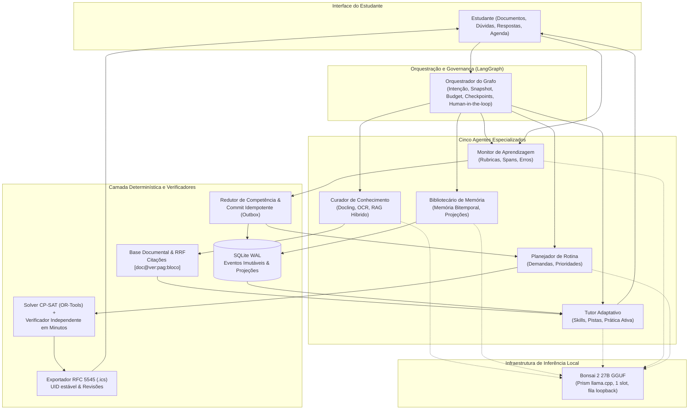

# EduAgent-OS — Sistema Multiagente Local para Tutoria Ativa e Gestão Longitudinal de Estudos

**MO810A / MC959A — Sistemas Multiagentes com Modelos de Linguagem**  
**Instituto de Computação (IC) — UNICAMP — 2026**  
**Docente:** Prof. Dr. Julio Cesar dos Reis  

---

## 👥 Integrantes da Dupla

| Nome | RA | E-mail / Contato |
| :--- | :---: | :--- |
| **Rafael Attilio Agricola** | `249245` | IC / UNICAMP |
| **Jociclelio Castro Macedo Junior** | `231722` | IC / UNICAMP |

---

## 📌 Sumário

1. [Visão Geral do Projeto](#-visão-geral-do-projeto)
2. [Premissas de Engenharia e Princípios Arquiteturais](#-premissas-de-engenharia-e-princípios-arquiteturais)
3. [Arquitetura Multiagente](#-arquitetura-multiagente)
   - [Os Cinco Agentes Lógicos](#os-cinco-agentes-lógicos)
   - [Diagrama da Arquitetura](#diagrama-da-arquitetura)
   - [Modelo Local e Inferência](#modelo-local-e-inferência)
4. [Componentes e Requisitos do Sistema (C01–C20)](#-componentes-e-requisitos-do-sistema-c01c20)
5. [Fluxos Operacionais, Saídas e Modos de Falha](#-fluxos-operacionais-saídas-e-modos-de-falha)
   - [Fluxos de Trabalho (W01–W12)](#fluxos-de-trabalho-w01w12)
   - [Catálogo de Saídas (O01–O18)](#catálogo-de-saídas-o01o18)
   - [Catálogo de Falhas (F01–F24) e Mitigações](#catálogo-de-falhas-f01f24-e-mitigações)
6. [Persistência, Transações e Governança de Efeitos](#-persistência-transações-e-governança-de-efeitos)
7. [Planejamento Temporal e Solver de Grade](#-planejamento-temporal-e-solver-de-grade)
8. [Metodologia de Avaliação e Testbed](#-metodologia-de-avaliação-e-testbed)
   - [Perguntas de Pesquisa](#perguntas-de-pesquisa)
   - [Condições Experimentais e Comparações](#condições-experimentais-e-comparações)
   - [Métricas e Critérios de Aceite](#métricas-e-critérios-de-aceite)
9. [Estrutura do Repositório](#-estrutura-do-repositório)
10. [Instalação, Configuração e Execução (EduAgent-OS v0.1 — Fase 3)](#-instalação-configuração-e-execução)
    - [Requisitos e Instalação das Dependências via `uv`](#1-requisitos-e-instalação-das-dependências-eduagent-os-v01)
    - [Obtenção dos Modelos e Dados Não Versionados](#2-obtenção-dos-modelos-e-dados-não-versionados)
    - [Configuração de Parâmetros e Variáveis de Ambiente](#3-configuração-de-parâmetros-e-variáveis-de-ambiente)
    - [Comandos de Execução (CLI, Interface Gráfica Local e Testes)](#4-comandos-de-execução-da-solução)
    - [Exemplo Completo de Entrada e Saída Ponta a Ponta](#5-exemplo-de-entrada-e-saída-ponta-a-ponta)
    - [Notebooks Pedagógicos da Disciplina](#notebooks-da-disciplina)
    - [Compilação e Verificação das Entregas (Fases 1, 2 e 3)](#compilação-dos-documentos-da-fase-1)
11. [Convenções de Desenvolvimento e Versionamento](#-convenções-de-desenvolvimento-e-versionamento)
12. [Referências Bibliográficas Fundamentais](#-referências-bibliográficas-fundamentais)

---

## 🎯 Visão Geral do Projeto

O **EduAgent-OS** é um sistema multiagente (MAS) voltado ao apoio integral a estudantes universitários de graduação. O sistema atua de ponta a ponta na rotina acadêmica:
1. **Ingestão e Fundamentação:** Processa documentos oficiais de disciplinas (Plano de Desenvolvimento de Disciplina — PDD, cronogramas, notas de aula, listas de exercícios e PDFs fornecidos pelo estudante);
2. **Tutoria Ativa e Formativa:** Conduz sessões de estudo interativas, com explicações socráticas, geração de exercícios graduados, flashcards atômicos e estímulo à autoexplicação;
3. **Monitoramento de Aprendizagem:** Avalia respostas discursivas e objetivas via rubricas pedagógicas estritas, diferenciando ajuda recebida de desempenho independente, e identificando concepções alternativas (*misconceptions*);
4. **Memória Longitudinal Bitemporal:** Preserva o histórico formativo e fatos acadêmicos ao longo do semestre com rastreabilidade temporal (`occurred_at` vs. `recorded_at`), permitindo correções retroativas sem perda de integridade;
5. **Planejamento de Estudos e Exportação de Calendário:** Mapeia defasagens pedagógicas e avaliações iminentes em demandas de estudo semanais, organizadas por um solver exato determinístico em slots de 15 minutos, gerando arquivos de calendário compatíveis com a RFC 5545 (iCalendar / `.ics`).

O projeto é guiado centralmente pelo **ODS 4 — Educação de Qualidade** (Meta 4.3 e 4.4 da ONU), promovendo a autonomia dos estudantes e o estudo sustentável, além de contribuir indiretamente com os **ODS 9 e 10** ao priorizar computação local acessível e soberania sobre dados pessoais.

---

## ⚙️ Premissas de Engenharia e Princípios Arquiteturais

- **Inferência Primariamente Local:** O núcleo operacional opera integralmente *offline* com modelos quantizados executados localmente via runtime especializado, garantindo privacidade estrita dos dados estudantis e previsibilidade de custos.
- **Coordenação por Grafo Explícito (LangGraph):** A orquestração não é um chat irrestrito ou emergente entre agentes, mas sim uma máquina de estados finitos direcionada, com rotas estritas, checkpoints transacionais, orçamentos limitados por turno e suporte a pausas para confirmação humana (*human-in-the-loop*).
- **Contratos Tipados Pydantic v2:** Todas as fronteiras de comunicação utilizam schemas Pydantic estritos (`extra='forbid'`), identificadores estáveis (UUID) e referências imutáveis baseadas em conteúdo (`*_ref`).
- **Primazia do Determinismo:** O Modelo de Linguagem (LLM) propõe conteúdo, hipóteses e demandas; verificadores e redutores determinísticos independentes validam restrições, persistem estados, aplicam rubricas e determinam a viabilidade matemática de agendas.
- **Ausência de Alucinações Silenciosas:** Diante de dados ilegíveis, prazos ambíguos ou ausência de fontes documentais, o sistema declara explicitamente abstenção, pendência ou conflito, jamais inventando fatos ou confirmando restrições sem intervenção do estudante.

---

## 🏛️ Arquitetura Multiagente

### Os Cinco Agentes Lógicos

1. **Curador de Conhecimento (`Curator`):**
   - *Responsabilidade:* Ingestão de arquivos (Docling + OCR seletivo), extração de tópicos e fatos acadêmicos candidatos, indexação e recuperação híbrida (RAG BM25 + BGE-M3 + RRF).
   - *Artefatos Produzidos:* Manifesto de blocos, catálogo de tópicos/prazos candidatos e `EvidencePack` estruturado com citações canônicas de proveniência `[doc_id@versão:página:bloco]`.
   - *Fronteira:* Não promove prazos automaticamente; não executa conteúdo documental como código ou comando.

2. **Tutor Adaptativo (`Tutor`):**
   - *Responsabilidade:* Condução pedagógica e geração de atividades a partir de um catálogo versionado de habilidades (*Skills*: explicação conceitual, pistas graduadas 1..3, quiz, flashcards e autoexplicação).
   - *Artefatos Produzidos:* Turnos pedagógicos (`TutorTurn`) e itens de aprendizagem (`LearningItem`) com gabarito e rubricas desacoplados da pergunta.
   - *Fronteira:* Termina o turno em espera explícita do estudante (`waiting_student`); não altera agendas nem infere domínio definitivo.

3. **Monitor de Aprendizagem (`Monitor`):**
   - *Responsabilidade:* Avaliação formativa das respostas dos estudantes com base no gabarito e em rubricas analíticas com níveis 0 (incorreto/ausente), 1 (parcial) e 2 (adequado).
   - *Artefatos Produzidos:* Avaliações formativas (`Assessment`), evidências de resposta com *spans* textuais comprovados e identificação de códigos de erro conceitual.
   - *Fronteira:* Não emite notas institucionais; abstém-se diante de ambiguidade; não converte autorrelato em comprovação de competência.

4. **Planejador de Rotina e Agenda (`Planner`):**
   - *Responsabilidade:* Traduz necessidades de estudo e revisões em demandas temporais (`StudyDemand`), interpretando preferências e restrições.
   - *Artefatos Produzidos:* Propostas de rotina semanal (`ScheduleProposal`), relatórios de conflito/inviabilidade e exportações iCalendar (`.ics`).
   - *Fronteira:* A viabilidade da agenda é formalizada e provada pelo solver CP-SAT e por um verificador independente, nunca pelo texto livre do LLM.

5. **Bibliotecário de Memória (`Librarian`):**
   - *Responsabilidade:* Recuperação e consolidação de eventos bitemporais, rastreamento de preferências corrigíveis, histórico de tentativas e sínteses de contexto sob limites estritos de tokens.
   - *Artefatos Produzidos:* Pacotes de memória (`MemoryPack`), projeções versionadas de competência por tópico e recibos de correção.
   - *Fronteira:* Não escreve diretamente no banco de dados; sínteses derivadas mantêm referências aos eventos originais para fins de auditoria e exclusão lógica.

---

### Diagrama da Arquitetura



---

### Modelo Local e Inferência

- **Modelo Candidato Adotado:** `prism-ml/Ternary-Bonsai-2-27B-gguf` (revisão `b072e1d3b35a0a630cece372c2127528e0994386`), arquivo `Ternary-Bonsai-2-27B-PTQ1_0.gguf` (alternativa de alta eficiência: `PQ2_0`).
- **Runtime Local:** Fork especializado `PrismML-Eng/llama.cpp` (release `prism-b10743-adfffbe`), executado como servidor HTTP loopback isolado com 1 slot de contexto e fila limitada a 4 requisições.
- **Orçamento de Janela de Contexto (32.768 tokens):**
  $$\text{Janela Total} = 32.768 \ge T_{\text{entrada}} + 16.384 \,(\text{saída}) + 2.048 \,(\text{ferramentas}) + 1.024 \,(\text{margem})$$
  Com limite estrito de $T_{\text{entrada}} \le 13.312$ tokens (fontes documentais até 4.096 tokens, memória até 2.048 tokens em até 8 unidades).
- **Gate de Admissão:** Antes da liberação, o modelo passa por testes de conformidade offline (tokenizer real, geração em português, parse de JSON estrito e recusa de ferramentas indevidas). Se reprovado, emite o status tipado `MODEL_NOT_ADMITTED`.

---

## 📋 Componentes e Requisitos do Sistema (C01–C20)

A especificação de engenharia divide o sistema em 20 componentes essenciais com critérios mensuráveis:

| ID | Componente | Responsabilidade e Critério Verificável |
| :---: | :--- | :--- |
| **C01** | **Inferência Local** | Execução offline via Bonsai 2 27B quantizado no fork Prism de llama.cpp; JSON Schema validado; servidor loopback com fila controlada. |
| **C02** | **Ingestão e Proveniência** | Parser Docling com OCR seletivo (OCRmyPDF) em português/inglês; blocos com bounding boxes e páginas físicas; diagnóstico de ilegibilidade. |
| **C03** | **Ontologia Acadêmica** | Entidades relacionais estruturadas (Curso, Tópico, Pré-requisito, Avaliação, Recurso) com timezone IANA e status de confiança (`candidate/ambiguous/confirmed`). |
| **C04** | **RAG Documental Híbrido** | Busca lexical BM25 (`rank_bm25`) combinada a busca densa BGE-M3 via RRF ($k=60$); reranker opcional BGE-v2-m3; citações canônicas estritas e abstenção explícita. |
| **C05** | **Curadoria Conectada (Opcional)** | Mecanismo de busca e fetch com cotas e limites (10 s, 5 MiB); rastreamento estrito de estados (`metadata_only`, `text_read`, `transcript_read`); sem URLs fictícias. |
| **C06** | **Tutor e Catálogo de Skills** | Habilidades pedagógicas versionadas em YAML (explicar, pistas graduadas, quiz, flashcard, autoexplicação); apoio contingente e respeito a paradas do aluno. |
| **C07** | **Monitor Formativo** | Julgamento por rubricas analíticas com níveis 0/1/2; correspondência com spans reais da resposta; diferenciação entre acerto independente e com auxílio. |
| **C08** | **Estado de Aprendizagem** | Rastreamento determinístico por tópico; classificação temporal em `insufficient`, `mixed` ou `favorable` provisório (após 3 acertos independentes consecutivos); estimativa numérica nula no MVP. |
| **C09** | **Memória Persistente Bitemporal** | SQLite com log imutável de eventos (`occurred_at` vs. `recorded_at`), fatos vigentes com encadeamento `supersedes` e isolamento estrito por usuário. |
| **C10** | **Gestão de Contexto e Síntese** | Contagem exata de tokens via tokenizer real; priorização de fatos críticos (prazos, ajuda e rubricas) antes de aplicar sumarização. |
| **C11** | **Planejador e Solver de Agenda** | Formalização matemática no Google OR-Tools (CP-SAT) em slots de 15 min no horizonte de 7 dias; checagem independente em minutos originais; tratamento de inviabilidade. |
| **C12** | **Exportação de Calendário (ICS)** | Geração de arquivos iCalendar RFC 5545 válidos via `icalendar`; UIDs e ocorrências estáveis; sincronização CalDAV/Google tratada como extensão opcional via Outbox. |
| **C13** | **Orquestração por Grafo** | Máquina de estados LangGraph; rotas fixas com limites de passos (máx 16) e chamadas LLM (máx 6); checkpoints persistentes com suporte a pausa e retomada. |
| **C14** | **Comunicação e Contratos** | Envelopes Pydantic v2 estritos com controle de versão de snapshot e referências tipadas; barreira de segurança impedindo injeção de instruções em payloads. |
| **C15** | **Política de Ferramentas** | Allowlist por papel de agente; validação programática de argumentos; bloqueio de caminhos fora da sandbox (anti-traversal) e negação de rede local em fetches. |
| **C16** | **Persistência e Recuperação** | SQLite WAL/FULL com transações atômicas curtas; suporte a replay pós-crash; controle de concorrência otimista via contador monotônico `domain_revision`. |
| **C17** | **Observabilidade e Limites** | Rastreamento local OpenTelemetry por turno; log de contadores reais de tokens, latência de fila, picos de RSS/VRAM e cancelamento limpo sob watchdog. |
| **C18** | **Conjunto de Dados e Ouro** | Corpus acadêmico de duas disciplinas de graduação (formal e conceitual); anotação independente por especialistas com rubricas de ouro e splits sem vazamento de famílias. |
| **C19** | **Avaliação Experimental** | Protocolo pareado contra agente único (SA) de mesmos recursos; ablações de arquitetura; bootstrap pareado por cluster ($B=10.000$); margem de não-inferioridade. |
| **C20** | **Empacotamento e Reprodutibilidade** | Manifesto imutável com hashes SHA-256 de dados, binários, pesos de modelo e lockfiles (`uv.lock`); scripts de verificação e smoke tests locais. |

---

## 🔄 Fluxos Operacionais, Saídas e Modos de Falha

### Fluxos de Trabalho (W01–W12)

| ID | Fluxo | Disparador | Saídas Principais | Término e Variações |
| :---: | :--- | :--- | :--- | :--- |
| **W01** | **Ingestão e Confirmação** | Upload de PDF/texto | O01 (Blocos), O02 (Fatos/Tópicos) | Concluído, pendência de confirmação ou erro de ilegibilidade/limite. |
| **W02** | **Consulta Fundamentada** | Pergunta do aluno | O03 (Evidências), O04 (Explicação) | Resposta fundamentada com citações, explicação rotulada ou abstenção explícita. |
| **W03** | **Prática e Apoio Gradual** | Pedido de estudo/treino | O05 (Item), O06 (Flashcard), O07 (Pistas) | Turno concluído, entrega de pistas (1..3), revelação de solução ou parada. |
| **W04** | **Avaliação Formativa** | Submissão de resposta | O08 (Avaliação), O09 (Estado/Revisão) | Avaliação aceita (níveis 0..2) ou abstenção; persistência no histórico. |
| **W05** | **Retomada Longitudinal** | Nova sessão de estudo | O10 (Memória), O11 (Síntese) | Contexto reconstituído com fatos vigentes e eventos recentes. |
| **W06** | **Planejamento Semanal** | Pedido de organização | O12 (Demandas), O13 (Proposta de Agenda) | Proposta viável apresentada, diagnóstico de conflito ou pedido de esclarecimento. |
| **W07** | **Replanejamento Dinâmico** | Erro formativo ou atraso | O09 (Revisão), O13 (Diff de Agenda) | Ajuste da grade respeitando compromissos fixos e histórico de ocorrências. |
| **W08** | **Exportação de Agenda** | Aprovação de plano | O14 (Arquivo .ics / Recibo) | Geração de ICS válido ou enfileiramento em outbox de sincronização. |
| **W09** | **Curadoria Conectada** | Busca de materiais extras | O15 (Recurso Curado com Status) | Metadados catalogados, transcrição processada ou fallback offline datado. |
| **W10** | **Gestão Explícita de Dados** | Correção ou exclusão | O10 (Memória Corrigida), O16 (Recibo) | Confirmação de escopo, invalidação de derivados e tombstone de exclusão. |
| **W11** | **Recuperação Operacional** | Crash, timeout ou cancel | O16 (Status de Recuperação), O17 (Traces) | Replay a partir de checkpoint, cancelamento seguro ou relatório de limite. |
| **W12** | **Instalação e Diagnóstico** | Comando `doctor` / restore | O18 (Manifesto / Diagnóstico) | Validação de dependências, integridade de banco de dados e testes de fumaça. |

---

### Catálogo de Saídas (O01–O18)

- **O01 (Manifesto e Blocos Documentais):** Texto extraído, ordem lógica de leitura, páginas físicas e hashes de blocos sem inversões.
- **O02 (Tópicos, Fatos e Prazos):** Entidades acadêmicas normalizadas, fusão de sinônimos e prazos com timezone sem promoções silenciosas.
- **O03 (Evidências e Citações):** Chunks textuais recuperados com formato canônico `[doc@ver:pag:bloco]` resolvível no snapshot.
- **O04 (Explicação Conceitual):** Texto pedagógico claro, correto, delimitado e apoiado nas fontes recuperadas.
- **O05 (Exercício / Quiz):** Enunciado decidível com gabarito formal desacoplado e critérios de equivalência pré-definidos.
- **O06 (Flashcard Atômico):** Par frente/verso atômico e balanceado, com indicação de fonte e sem vazamento precoce da resposta.
- **O07 (Turno de Apoio / Pista):** Intervenção contingente baseada na dificuldade demonstrada, respeitando os 3 níveis de dicas e paradas legítimas.
- **O08 (Avaliação Formativa):** Parecer estruturado com níveis 0/1/2, vinculação a *spans* reais da resposta do aluno e identificação de equívocos.
- **O09 (Estado de Aprendizagem):** Projeção reproduzível da competência por tópico, preservando o grau de ajuda e registrando revisões devidas.
- **O10 (Memória Temporal):** Recuperação de fatos vigentes e eventos passados sem contaminação entre usuários ou ressurgimento de fatos substituídos.
- **O11 (Síntese de Contexto):** Compactação sob limite estrito de tokens preservando prazos, polaridade e evidências críticas.
- **O12 (Demandas de Estudo):** Demandas mapeadas a partir de avaliações e defasagens, com distinção clara entre durações estimadas e confirmadas.
- **O13 (Proposta de Agenda):** Grade temporal em blocos contíguos sem sobreposições, acompanhada de diff em relação ao plano anterior.
- **O14 (Arquivo de Calendário .ics):** Serialização RFC 5545 sem perdas de timezone, com UIDs e números de sequência estáveis.
- **O15 (Recurso Curado):** Metadados e links verificados, com atestado de acesso real e sem resumos fictícios de vídeos sem transcrição.
- **O16 (Recibo de Transação):** Identificador unívoco de operação persistida, atestando atomicidade e estado de efeitos colaterais.
- **O17 (Telemetria e Traces):** Spans detalhados de execução, consumo de tokens, latências decompostas e registros de falhas.
- **O18 (Diagnóstico e Manifesto):** Checksum de artefatos, registro de hardware, versão de dependências e estado de saúde operacional.

---

### Catálogo de Falhas (F01–F24) e Mitigações

O sistema implementa barreiras arquiteturais contra 24 modos de falha catalogados:

```
[Falhas de Entrada e Ingestão]
  F01 (Erro de OCR/Tabela) ─────────► Diagnóstico de qualidade e recusa de promoção sem verificação
  F02 (Ambiguidade de Prazo) ──────► Intervenção humana obrigatória para confirmação de datas

[Falhas de Recuperação e Geração]
  F03 (Omissão de Fontes) ─────────► Busca híbrida (BM25 + BGE-M3 + RRF) e abstenção explícita
  F04 (Alucinação de Citação) ─────► Verificador canônico de resolução [doc@ver:pag:bloco]
  F05 (Vazamento de Solução) ──────► Protocolo estrito de 3 pistas e encerramento a pedido do aluno
  F06 (Viés no Monitor) ───────────► Rubricas analíticas 0/1/2 e desacoplamento do Tutor

[Falhas de Estado e Memória]
  F07 (Atribuição Incorreta) ──────► Redutor determinístico separa acerto independente de assistido
  F08 (Anacronismo Temporal) ──────► Rastreamento bitemporal (occurred_at vs. recorded_at)
  F09 (Perda na Compactação) ──────► Validador de preservação de tuplas críticas e prazos
  F10 (Incompatibilidade de Schema)► Validação Pydantic v2 estrita (extra='forbid')

[Falhas Operacionais e de Orquestração]
  F11 (Loop no Grafo) ─────────────► Limite máximo de 16 passos e 6 chamadas LLM por turno
  F12 (Estouro de Contexto/OOM) ───► Janela reservada fixa (32k) e watchdog ativo de 120 s
  F13 (Conflito no Solver) ────────► Verificador independente em minutos originais
  F14 (Concorrência/Stale Data) ───► Controle de concorrência por domain_revision monotônica
  F15 (Falha de Envio/Crash) ──────► Padrão Outbox transacional e reconciliação por idempotência

[Falhas de Segurança e Integridade]
  F16 (Prompt Injection em PDF) ──► Tratamento de dados documentais como texto passivo rotulado
  F17 (Escape de Diretório/User) ──► Validação de caminhos canônicos e isolamento por user_id
  F18 (Corrupção de SQLite) ──────► Modo WAL/FULL e replays a partir de log de eventos
  F19 (Indisponibilidade de Rede) ──► Fallback graceful com operação núcleo 100% offline
  F20 (Erro no Arquivo .ics) ──────► Serialização RFC 5545 auditada por parser independente
  F21 (Ressurgimento de Excluídos)─► Invalidação em cascata via tabela artifact_dependencies
  F22 (Subcontagem de Custos) ─────► Instrumentação externa de telemetria em todas as chamadas
  F23 (Viés na Avaliação) ─────────► Avaliação cega pareada com rotação de ordem e oráculos
  F24 (Ambiente Não Reprodutível) ─► Manifesto imutável, locks de dependências e seeds fixas
```

---

## 💾 Persistência, Transações e Governança de Efeitos

1. **Modelo de Armazenamento SQLite WAL:**
   - O banco relacional utiliza modo `WAL` (*Write-Ahead Logging*) com escrita serializada, transações curtas e constraints habilitados.
   - O schema segrega dados brutos, eventos imutáveis, projeções atualizáveis e logs de operações:
     - `users`, `courses`, `topics`, `topic_edges`
     - `documents`, `doc_versions`, `blocks`, `chunks`
     - `facts` (com `status`, `authority` e encadeamento `supersedes`)
     - `events`, `items`, `attempts`, `assessments`, `topic_states`
     - `demands`, `plans`, `logical_blocks`
     - `operations`, `outbox`, `confirmations`, `artifact_dependencies`
2. **Controle de Concorrência por `domain_revision`:**
   - Cada usuário possui um contador monotônico global (`users.domain_revision`).
   - Qualquer mutação confirmada incrementa o contador atômica e monotonicamente. O snapshot lido pelos agentes carrega essa revisão fixa. Tentativas de gravação com revisão defasada resultam em `VERSION_CONFLICT`, exigindo releitura.
3. **Idempotência Estrita via `operation_id`:**
   - Antes de aplicar qualquer commit, o serviço verifica se o `operation_id` já existe:
     - Se o ID e o digest forem idênticos: retorna imediatamente o recibo original registrado, mesmo que a versão esperada esteja desatualizada.
     - Se o digest ou usuário forem divergentes: rejeita a requisição como erro.
4. **Padrão Outbox para Efeitos Externos:**
   - Exportações remotas de agenda ou notificações são gravadas na tabela `outbox` na mesma transação que confirma o plano.
   - Um dispatcher independente com concessão temporal (*lease*) processa a fila, garantindo entrega com reconciliação pós-timeout (*at-least-once* controlado por identidade).
5. **Privacidade e Exclusão Lógica Auditável:**
   - A tabela `artifact_dependencies` mapeia relacionamentos pai-filho (`derived_from`, `corrects`, `supersedes`).
   - Pedidos de exclusão de dados pessoais propagam imediatamente a invalidação para projeções, caches e resumos derivados, aplicando marcadores *tombstone* sem manter hashes reversíveis de textos removidos.

---

## 📅 Planejamento Temporal e Solver de Grade

O módulo de planejamento traduz objetivos educacionais em rotinas práticas de estudo:

1. **Geração Determinística de Demandas (`assessment_review_policy_v1`):**
   - Tentativa incorreta ou erro crítico $\rightarrow$ revisão sugerida no próximo dia com disponibilidade.
   - Acerto independente $\rightarrow$ revisões espaçadas candidatas em 1, 3 e 7 dias.
   - Prioridades:
     - **Classe 1 (Alta):** Avaliação institucional em até 48 h ou erro conceitual crítico recente.
     - **Classe 2 (Média):** Avaliação em até 7 dias, revisão vencida ou dificuldade persistente.
     - **Classe 3 (Normal):** Demais atividades e manutenções periódicas de estudo.
2. **Formulações no CP-SAT (Google OR-Tools):**
   - O horizonte cobre 7 dias a partir da meia-noite local (convertida para UTC).
   - Grade discretizada em slots de 15 minutos: demandas de $d_i$ minutos ocupam $\lceil d_i/15\rceil$ slots.
   - Variáveis binárias $x_b \in \{0, 1\}$ indicam a alocação de blocos candidatos $b \in B_i$.
   - Restrições lineares garantem:
     $$\sum_{b \in B_i} x_b = 1 \quad (\text{para obrigatórias}), \qquad \sum_{b: t \in b} x_b \le 1 \quad (\forall \text{ slot } t)$$
     $$end_i \le start_j \quad (\text{precedência temporal de pré-requisitos confirmados})$$
   - Otimização lexicográfica: (1) maximizar demandas opcionais de Classe 1, 2 e 3; (2) minimizar alterações em blocos previamente aprovados (*churn*); (3) minimizar deslocamentos temporais; (4) maximizar janelas preferidas declaradas pelo estudante.
3. **Verificador Independente em Minutos Originais:**
   - Um validador separado confere a solução diretamente nos minutos contínuos e instantes UTC originais, conferindo precedências, intervalos e imutabilidade de compromissos fixos antes de gerar a pré-visualização.
4. **Serialização e Sincronização RFC 5545:**
   - Emissão de eventos `VEVENT` com UIDs estáveis por ocorrência lógica (`activity_occurrence_id`).
   - Timestamps `CREATED`, `DTSTAMP` e `LAST-MODIFIED` refletem o versionamento persistido sem alterações espúrias em retries, mantendo o campo `SEQUENCE` sincronizado com alterações de conteúdo.

---

## 🧪 Metodologia de Avaliação e Testbed

### Perguntas de Pesquisa

- **Q1 (Especialização Multiagente):** A divisão do sistema em 5 agentes especializados, orquestrados em grafo com contratos estritos, proporciona maior taxa de sucesso de tarefas (TSR) e continuidade longitudinal quando comparada a um agente único (*Single Agent*) dotado do mesmo modelo, ferramentas e orçamento de contexto?
- **Q2 (Eficiência e Compactação de Contexto):** A seleção seletiva de habilidades e a compactação de memória bitemporal reduzem significativamente o consumo de tokens e latência mantendo a qualidade das saídas dentro de uma margem pré-fixada de não-inferioridade ($\Delta \le 0{,}03$)?
- **Q3 (Robustez e Contenção de Falhas):** Contratos tipados, validadores determinísticos independentes e políticas de autorização impedem que falhas de inferência ou perturbações operacionais gerem efeitos indevidos ou estados inconsistentes?

---

### Condições Experimentais e Comparações

O testbed avalia o sistema sob desenho pareado com controle rigoroso de orçamentos e sementes aleatórias (seeds 0 a 4):

1. `MA_FULL`: EduAgent-OS multiagente completo (cinco papéis, grafo, memória bitemporal, skills seletivas, solver exato);
2. `SA_EQUIVALENT`: Agente único equivalente, compartilhando o mesmo modelo Bonsai 2, os mesmos dados, ferramentas, limites de chamadas e verificadores determinísticos;
3. `MA_NO_LONG_MEMORY`: Ablação multiagente sem acesso à memória episódica longitudinal entre sessões;
4. `MA_NO_COMPACTION`: Ablação multiagente sem sumarização estruturada de contexto (mantendo apenas seleção de originais);
5. `MA_ALL_SKILLS`: Ablação multiagente com todas as instruções de habilidades carregadas estaticamente no prompt;
6. `MA_REDUCED_SKILL`: Contraste focal comparando a mesma habilidade com instrução completa versus instrução condensada.

---

### Métricas e Critérios de Aceite

| Dimensão | Métrica / Oráculo | Critério / Gate Proposto |
| :--- | :--- | :--- |
| **Ingestão (O01/O02)** | CER/WER via JiWER sobre transcrição humana; F1 de entidades; exatidão de datas | Exact Match Crítico $\ge 0{,}98$; F1 $\ge 0{,}90$; zero prazo ambíguo promovido sem confirmação |
| **RAG e Citação (O03)** | Recall@40, MRR@6, nDCG@6; Precisão de Citação (CP) e Cobertura (CR) | Recall $\ge 0{,}90$; CP $\ge 0{,}95$; abstenção explícita em perguntas sem suporte documental |
| **Tutoria (O04/O07)** | Rubrica humana cega 0–4 (corretude, pertinência, clareza, limites); máquina de estados | Mediana $\ge 3$ por dimensão; zero erro crítico nos casos aceitos; 100% de paradas respeitadas |
| **Prática (O05/O06)** | Validade de itens/cards por especialistas e resolvedor determinístico; separação de gabarito | Validade $\ge 0{,}95$; zero verso de flashcard vazado antecipadamente |
| **Avaliação Formativa (O08)** | Concordância de Cohen/Fleiss ($\kappa$ ponderado); macro-F1 de equívocos; falso crédito | $\kappa \ge 0{,}70$; Falso Crédito $\le 0{,}05$ com divulgação de cobertura de aceitação |
| **Memória (O09/O10)** | Replay determinístico de eventos; acurácia temporal bitemporal; ausência de vazamento | 100% replay equivalente; Acurácia Temporal $\ge 0{,}90$; zero vazamento entre usuários |
| **Agenda (O13/O14)** | Verificador independente em minutos; conformidade RFC 5545; diff de blocos | Zero sobreposição ou violação publicada; 100% de equivalência plano $\leftrightarrow$ .ics |
| **Sucesso Global** | Task Success Rate (TSR); Taxa de Disponibilidade de Artefatos ($A_O$) | TSR longitudinal superior ao baseline; zero violação crítica publicada |
| **Robustez (F01–F24)** | FaultController com injeção de falhas (ruído, injeção adversarial, crashpoints SIGKILL) | Contenção segura comprovada; zero efeito duplicado pós-crash; isolamento de paths 100% |
| **Estatística** | Bootstrap pareado por cluster ($B=10.000$, IC95%); correção de Holm para secundárias | Diferença significativa pareada em TSR com limite inferior do IC95% $> 0$ |

---

## 📁 Estrutura do Repositório

```text
.
├── README.md                           # Documento principal do repositório (este arquivo)
├── pyproject.toml                      # Manifesto de dependências e pacote do EduAgent-OS v0.1
├── uv.lock                             # Lockfile determinístico congelado (SHA-256 verificado)
├── manifest.json                       # Manifesto congelado (modelo, runtime, skills, BGE-M3, Docling)
├── config/
│   └── default.yaml                    # Parâmetros operacionais, limites de contexto e timeouts
├── .env.example                        # Modelo de configuração de variáveis de ambiente (sem segredos)
├── .gitattributes                      # Normalização LF global e exceção CRLF para *.ics (RFC 5545)
├── .editorconfig                       # Padronização de codificação UTF-8 e fins de linha
│
├── eduagent/                           # Núcleo Multiagente Implementado (EduAgent-OS v0.1)
│   ├── cli.py                          # CLI oficial (`eduagent`) com 14 subcomandos + `--serve-ui`
│   ├── api.py                          # API HTTP Loopback concorrente (`ThreadingHTTPServer`)
│   ├── runtime.py                      # Inicialização integrada (`RuntimeContext`)
│   ├── config.py                       # Resolução automática de timezone IANA + fallback interativo
│   ├── contracts.py                    # Contratos tipados Pydantic v2 (`extra="forbid"`)
│   ├── graph.py                        # Máquina de estados finitos (`EduAgentGraph` / LangGraph)
│   ├── policy.py                       # Allowlists de ferramentas por papel e confinamento de paths
│   ├── telemetry.py                    # Traces estruturados locais por turno e span
│   ├── agents/                         # Os 5 agentes especializados
│   │   ├── curator.py                  # Curador de Conhecimento (ingestão, fatos e citações)
│   │   ├── librarian.py                # Bibliotecário de Memória (memória bitemporal e síntese)
│   │   ├── tutor.py                    # Tutor Adaptativo (escada socrática L0..L3 e prática)
│   │   ├── monitor.py                  # Monitor de Aprendizagem (rubricas analíticas 0/1/2)
│   │   └── planner.py                  # Planejador de Rotina (demandas, CP-SAT e revisão)
│   ├── services/                       # Serviços determinísticos e ferramentas
│   │   ├── ingestion.py                # Extração Docling isolada em subprocesso `spawn` (4 GiB)
│   │   ├── retrieval.py                # RAG híbrido: BM25 + BGE-M3 + RRF (k=60)
│   │   ├── memory.py                   # Ledger bitemporal (`occurred_at` vs. `recorded_at`)
│   │   ├── assessment.py               # Julgamento formativo e redutor `TopicState`
│   │   ├── scheduling.py               # Solver CP-SAT (5 estágios) + verificador em minutos
│   │   ├── calendar.py                 # Exportador RFC 5545 (`.ics`) com UID/SEQUENCE estáveis
│   │   ├── effects.py                  # Commit idempotente (`operation_id`) e fila `Outbox`
│   │   ├── backup.py                   # Backup consistente, restore verificado e deleção lógica
│   │   └── model_adapter.py            # Adaptador HTTP loopback para o fork PrismML llama.cpp
│   ├── skills/                         # Catálogo versionado de habilidades pedagógicas
│   │   ├── catalog.json                # Índice com hashes SHA-256 congelados
│   │   ├── loader.py                   # Carregador e validador de integridade das skills
│   │   └── *.yaml                      # 5 skills: explain, graduated_hint, quiz, flashcard, self_explain
│   └── storage/                        # Camada de persistência relacional
│       ├── migrations.py               # DDL SQLite WAL/FULL (20 tabelas)
│       ├── repository.py               # `DomainStore` com controle monotônico `domain_revision`
│       └── checkpoints.py              # `SQLiteCheckpointer` para pausa/retomada de sessões
│
├── ui/                                 # Interface Gráfica Local (Web SPA 100% Offline)
│   ├── src/                            # Contratos TypeScript (`contracts.ts`) e estado (`state.ts`)
│   ├── dist/                           # Ativos servidos em `/` e `/ui/*` (`index.html`, `styles.css`, `app.js`)
│   └── tests/                          # Suíte automatizada de frontend (`ui_automated_test.ts` via Deno)
│
├── schemas/                            # 15 contratos JSON Schema Draft 2020-12 exportados
├── eval/                               # Ensaio funcional ponta a ponta e relatórios de aceite
│   ├── ensaio_longitudinal.py          # Protocolo executável de 15 passos com o modelo local real
│   └── relatorio-testes-mvp.md         # Relatório do ensaio longitudinal e aceite §13.235
├── tests/                              # Suíte automatizada Pytest (600 testes de sistema e gates)
│
├── fase1/                              # Fase 1: Proposta inicial e slides Beamer
├── fase2/                              # Fase 2: Metodologia, mapas normativos (01..11) e relatório PDF
└── fase3/                              # Fase 3: Resultados práticos, roteiro de demo e relatório PDF
    ├── MO810_2026-Fase3-Instruções.pdf # Enunciado oficial da Fase 3
    ├── template-fase3.tex              # Template oficial disponibilizado na disciplina
    ├── fase3_resultado_pratico.tex     # Fonte LaTeX do relatório técnico da Fase 3
    ├── fase3_resultado_pratico.pdf     # Relatório compilado (capa + máx. 3 páginas de conteúdo)
    ├── fase3_resultado_pratico_rafael-attilio-agricola_jociclelio-castro-macedo-junior.pdf
    ├── references.bib                  # Referências bibliográficas citadas na Fase 3
    ├── roteiro_demo_3min.md            # Roteiro cronometrado para o vídeo demo (máx. 3 min)
    ├── README-entrega.md               # Guia de conferência da entrega da Fase 3
    ├── SHA256SUMS.txt                  # Digests SHA-256 dos artefatos da Fase 3
    ├── verificacao_documental.json     # Resultado da verificação mecânica da Fase 3
    └── scripts/                        # Verificador stdlib e compilador isolado da Fase 3
        ├── verificar_documentos.py
        └── gerar_entrega.py
```

---

## 🚀 Instalação, Configuração e Execução

### 1. Requisitos e Instalação das Dependências (EduAgent-OS v0.1)

O **EduAgent-OS v0.1** requer:
- **Python 3.11+** (desenvolvido e congelado em Python `3.12.13` com `SQLite 3.53.1`);
- Gerenciador de pacotes **[`uv`](https://docs.astral.sh/uv/)** para reprodução exata do `uv.lock`;
- *(Opcional para testes de frontend)* **Deno 1.40+** para rodar `ui/tests/ui_automated_test.ts`;
- *(Opcional para recompilar relatórios LaTeX)* **TeX Live** (`pdflatex` e `bibtex`).

```bash
# 1. Clonar o repositório e acessar a pasta raiz
git clone --recurse-submodules https://github.com/Jociclelio/Multi-Agent-Cognitive-Assist-Interface.git
cd Multi-Agent-Cognitive-Assist-Interface

# 2. Criar o ambiente virtual (.venv) e instalar as dependências congeladas no uv.lock
uv sync --frozen --group dev

# 3. Verificar a integridade dos 15 contratos JSON Schema exportados
uv run python -m eduagent.contracts --check
```

---

### 2. Obtenção dos Modelos e Dados Não Versionados

Por restrições de tamanho de repositório Git (dezenas de gigabytes em pesos binários), os pesos do LLM local e do embedder denso são listados no `.gitignore` e verificados por hash SHA-256 em [`manifest.json`](manifest.json). Para obtê-los:

1. **Modelo de Linguagem Local (`Ternary-Bonsai-2-27B-PTQ1_0.gguf`):**
   - Repositório Hugging Face: [`prism-ml/Ternary-Bonsai-2-27B-gguf`](https://huggingface.co/prism-ml/Ternary-Bonsai-2-27B-gguf) (revisão `b072e1d3b35a0a630cece372c2127528e0994386`).
   - SHA-256 esperado do arquivo GGUF: `53107f530aa52eb00912263ab1ee29bd199261c87cd7b4ad4ca1318c1fe33ee3`.
   ```bash
   mkdir -p runner-llm/models/Ternary-Bonsai-2-27B-gguf
   huggingface-cli download prism-ml/Ternary-Bonsai-2-27B-gguf \
     Ternary-Bonsai-2-27B-PTQ1_0.gguf \
     --revision b072e1d3b35a0a630cece372c2127528e0994386 \
     --local-dir runner-llm/models/Ternary-Bonsai-2-27B-gguf
   ```
2. **Runtime Local (`PrismML-Eng/llama.cpp`):**
   - O formato ternário `PTQ1_0` (1,75 bpw) utiliza o fork [`PrismML-Eng/llama.cpp`](https://github.com/PrismML-Eng/llama.cpp) (branch `prism`, tag `prism-b10743-adfffbe` / commit `84445367fbaf79c00ff64bc93a0689cdb3eee54d`):
   ```bash
   git clone --branch prism https://github.com/PrismML-Eng/llama.cpp.git runner-llm/third_party/llama.cpp
   cmake -S runner-llm/third_party/llama.cpp -B runner-llm/build -DGGML_CUDA=ON
   cmake --build runner-llm/build --config Release -j --target llama-server

   # Iniciar o servidor HTTP em loopback (127.0.0.1:8079), 1 slot e contexto de 32.768 tokens:
   ./runner-llm/build/bin/llama-server \
     -m runner-llm/models/Ternary-Bonsai-2-27B-gguf/Ternary-Bonsai-2-27B-PTQ1_0.gguf \
     --host 127.0.0.1 --port 8079 -np 1 -c 32768 --seed 42 --alias bonsai2-ptq1-0
   ```
3. **Modelo de Embeddings Denso (`BAAI/bge-m3`):**
   - Repositório Hugging Face: [`BAAI/bge-m3`](https://huggingface.co/BAAI/bge-m3) (revisão `5617a9f61b028005a4858fdac845db406aefb181`).
   ```bash
   mkdir -p runner-llm/models/bge-m3
   huggingface-cli download BAAI/bge-m3 \
     --revision 5617a9f61b028005a4858fdac845db406aefb181 \
     --local-dir runner-llm/models/bge-m3
   ```
4. **Modelos de Layout do `Docling`:** baixados automaticamente na primeira execução do `DoclingExtractor` (`docling-project/docling-layout-heron` e `docling-project/docling-models`).

---

### 3. Configuração de Parâmetros e Variáveis de Ambiente

1. Copie o arquivo `.env.example` para `.env`:
   ```bash
   cp .env.example .env
   ```
2. Os limites operacionais e orçamentos de tokens ficam em [`config/default.yaml`](config/default.yaml) (`window: 32768`, `max_output_tokens: 16384`, `doc_tokens: 4096`, `memory_tokens: 2048`, `max_llm_calls: 6`, `max_graph_steps: 16`, `slot_minutes: 15`, `horizon_days: 7`).
3. **Fuso Horário Automático (`eduagent/config.py`):** O sistema detecta automaticamente o fuso horário IANA do sistema operacional (`EDUAGENT_TIMEZONE`, `TZ`, `/etc/timezone`, `/etc/localtime` ou `astimezone()`) ou do navegador na Interface Gráfica Local (`POST /settings/timezone`), contando com fallback interativo caso o ambiente reporte apenas UTC genérico.

---

### 4. Comandos de Execução da Solução

#### A. Interface Gráfica Local (Web SPA + Loopback HTTP API)
```bash
# Inicia o servidor HTTP loopback em http://127.0.0.1:8094 e abre o navegador:
uv run eduagent --serve-ui --data-root data --port 8094 --open-browser

# Ou diretamente via módulo da API:
uv run python -m eduagent.api --data-root data --port 8094 --open-browser
```

#### B. Linha de Comando (`eduagent` — 14 Subcomandos Normativos)
```bash
# 1. Diagnóstico completo de saúde (SQLite WAL, manifesto, timezone e modelo):
uv run eduagent --data-root data doctor

# 2. Executar o ensaio longitudinal completo de 15 passos ponta a ponta:
uv run python eval/ensaio_longitudinal.py \
  --root /tmp/opencode/ensaio_fase3 \
  --model-url http://127.0.0.1:8079/v1 \
  --model-id bonsai2-ptq1-0 \
  --embedder-dir runner-llm/models/bge-m3 \
  --step all
```

#### C. Suítes de Testes Automatizados (600 Testes Pytest + 6 Suítes Deno)
```bash
# Suíte completa do núcleo, agentes, ferramentas, persistência e API/UI E2E:
uv run pytest tests/

# Suíte automatizada de estado e invariantes do frontend TypeScript:
deno test --allow-read ui/tests/ui_automated_test.ts
```

---

### 5. Exemplo de Entrada e Saída Ponta a Ponta

Abaixo está um exemplo real e reprodutível de entrada e saída demonstrando os 5 agentes em operação sobre a CLI (`eduagent`) e a API Loopback:

#### Passo 1 — Diagnóstico de Saúde (`doctor`)
**Entrada:**
```bash
uv run eduagent --data-root /tmp/opencode/ensaio_fase3/data doctor
```
**Saída (JSON):**
```json
{
  "status": "ok",
  "sqlite": { "version": "3.53.1", "wal_ok": true, "integrity": "ok" },
  "timezone": { "resolved": "America/Sao_Paulo", "source": "system_auto:env" },
  "model": { "status": "configured", "admitted": true },
  "connectors": { "network_enabled": false, "web_search": "CONNECTOR_DISABLED" }
}
```

#### Passo 2 — Ingestão Documental e Gate de Fato Ambíguo (`Curador` — `ingest` $\rightarrow$ `resume`)
**Entrada:**
```bash
uv run eduagent --data-root /tmp/opencode/ensaio_fase3/data \
  --user 123e4567-e89b-12d3-a456-426614174000 \
  --embedder-dir runner-llm/models/bge-m3 \
  ingest --file /tmp/opencode/ensaio_fase3/aula_idempotencia.pdf \
  --course 00000000-0000-0000-0000-000000000021 \
  --session 7c9e6679-7425-40de-944b-e07fc1f90ae7
```
**Saída inicial (Pausa *Fail-Closed* para confirmação de data ambígua):**
```json
{
  "status": "waiting",
  "session_id": "7c9e6679-7425-40de-944b-e07fc1f90ae7",
  "intent": "ingest",
  "waiting_for": "user",
  "interrupted": {
    "kind": "ambiguous_fact_confirmation",
    "ambiguous_count": 2,
    "message": "Confirme os fatos/prazos candidatos extraídos antes de ativar a versão documental."
  }
}
```
**Entrada de Confirmação (`resume`) e Saída Final:**
```bash
uv run eduagent --data-root /tmp/opencode/ensaio_fase3/data \
  --user 123e4567-e89b-12d3-a456-426614174000 \
  --embedder-dir runner-llm/models/bge-m3 \
  resume --session 7c9e6679-7425-40de-944b-e07fc1f90ae7 --data '{"confirmed": true}'
```
```json
{
  "status": "completed",
  "intent": "ingest",
  "output": {
    "doc_id": "d8b41a20-5a1c-4e82-9b12-90a1b2c3d4e5",
    "version_status": "active",
    "indexed_chunks": 4,
    "confirmed_facts": 3
  }
}
```

#### Passo 3 — Prática Ativa, Pistas Graduadas e Avaliação por Rubrica (`Bibliotecário` + `Tutor` + `Monitor`)
**Entrada (`practice` e `submit`):**
```bash
uv run eduagent --data-root /tmp/opencode/ensaio_fase3/data \
  --user 123e4567-e89b-12d3-a456-426614174000 \
  --model-url http://127.0.0.1:8079/v1 \
  --embedder-dir runner-llm/models/bge-m3 \
  practice "Gerar exercício sobre commit idempotente" \
  --course 00000000-0000-0000-0000-000000000021 \
  --topic 00000000-0000-0000-0000-000000000011 \
  --session 7c9e6679-7425-40de-944b-e07fc1f90ae7

uv run eduagent --data-root /tmp/opencode/ensaio_fase3/data \
  --user 123e4567-e89b-12d3-a456-426614174000 \
  --model-url http://127.0.0.1:8079/v1 \
  submit "A deduplicação por operation_id precede a checagem de domain_revision para devolver o recibo original em retries sem duplicar efeitos." \
  --session 7c9e6679-7425-40de-944b-e07fc1f90ae7
```
**Saída da Avaliação Formativa (`Assessment` + `TopicState`):**
```json
{
  "status": "completed",
  "intent": "submit",
  "output": {
    "assessment": {
      "correctness": "correct",
      "help_level": 0,
      "independent": true,
      "criteria_scores": [{ "criterion_id": "dedup", "level": 2 }]
    },
    "topic_state": {
      "topic_id": "00000000-0000-0000-0000-000000000011",
      "status": "mixed",
      "estimate": null
    }
  }
}
```

#### Passo 4 — Planejamento CP-SAT, Aprovação e Exportação RFC 5545 (`Planejador` — `plan` $\rightarrow$ `approve` $\rightarrow$ `export`)
**Entrada:**
```bash
uv run eduagent --data-root /tmp/opencode/ensaio_fase3/data \
  --user 123e4567-e89b-12d3-a456-426614174000 \
  plan --session 9a8b7c6d-1111-4222-8333-444455556666

uv run eduagent --data-root /tmp/opencode/ensaio_fase3/data \
  --user 123e4567-e89b-12d3-a456-426614174000 \
  approve --session 9a8b7c6d-1111-4222-8333-444455556666

uv run eduagent --data-root /tmp/opencode/ensaio_fase3/data \
  --user 123e4567-e89b-12d3-a456-426614174000 \
  export --session 9a8b7c6d-1111-4222-8333-444455556666
```
**Saída (`export`):**
```json
{
  "status": "completed",
  "intent": "export",
  "output": {
    "solver_status": "OPTIMAL",
    "verifier_passed": true,
    "events_count": 3,
    "ics_path": "data/123e4567-e89b-12d3-a456-426614174000/exports/plan_latest.ics"
  }
}
```

---

### Notebooks da Disciplina

Para explorar os notebooks pedagógicos da disciplina em `docs/notebooks/` (ambiente independente do EduAgent-OS, consulte `docs/INDEX.yml`):

```bash
jupyter notebook docs/notebooks/introducao-langchain.ipynb
```

---

### Compilação dos Documentos da Fase 1

```bash
tectonic fase1/fase1_slides.tex
```

---

### Compilação, Validação e Pacote da Fase 2

```bash
python3 fase2/scripts/verificar_documentos.py
python3 fase2/scripts/gerar_entrega.py
```

---

### Compilação, Validação e Pacote da Fase 3

A pasta `fase3/` contém o verificador documental e o script de compilação isolada do relatório de resultados práticos (validando as 7 seções obrigatórias, a declaração de IA, a ausência de *overfull boxes* e o limite máximo de 3 páginas fora a capa):

```bash
# 1. Verificar a integridade do relatório e dos artefatos da Fase 3:
python3 fase3/scripts/verificar_documentos.py

# 2. Compilar o PDF da Fase 3 e gerar checksums SHA-256 e pacote ZIP:
python3 fase3/scripts/gerar_entrega.py
```

---

## 🤝 Convenções de Desenvolvimento e Versionamento

- **Controle de Branches e Commits:** Mensagens de commit em português, concisas e orientadas à ação.
- **Segurança de Dados:** Arquivos de dados sensíveis, credenciais (`.env`), pesos de modelos (`*.gguf`) e bancos de runtime (`data/*.sqlite`) nunca são commitados.
- **Transparência de Estatuto Científico:** A Fase 3 comprova a execução funcional ponta a ponta do sistema multiagente implementado (`eval/relatorio-testes-mvp.md`); os experimentos comparativos (`MA_FULL` vs. `SA_EQUIVALENT`) e ablações estatísticas pertencem à Fase 4 (Mapa 08).

---

## 📚 Referências Bibliográficas Fundamentais

1. **MetaGPT:** Hong, S., et al. (2024). *MetaGPT: Meta programming for a multi-agent collaborative framework*. ICLR 2024. [arXiv:2308.00352](https://arxiv.org/abs/2308.00352).
2. **MultiTutor:** Sun, E., & Tai, L. (2025). *MultiTutor: Collaborative LLM agents for multimodal student support*. PMLR 273.
3. **MemGPT:** Packer, C., et al. (2023). *MemGPT: Towards LLMs as operating systems*. [arXiv:2310.08560](https://arxiv.org/abs/2310.08560).
4. **Voyager:** Wang, G., et al. (2023). *Voyager: An open-ended embodied agent with large language models*. [arXiv:2305.16291](https://arxiv.org/abs/2305.16291).
5. **ToRA:** Gou, Z., et al. (2024). *ToRA: A tool-integrated reasoning agent for mathematical problem solving*. ICLR 2024. [arXiv:2309.17452](https://arxiv.org/abs/2309.17452).
6. **BGE-M3:** Chen, J., et al. (2024). *M3-Embedding: Multi-linguality, multi-functionality, multi-granularity text embeddings*. [arXiv:2402.03216](https://arxiv.org/abs/2402.03216).
7. **RRF:** Cormack, G. V., Clarke, C. L., & Buettcher, S. (2009). *Reciprocal rank fusion outperforms condorcet and individual rank learning methods*. SIGIR 2009.
8. **CP-SAT Solver:** Google Optimization Tools (OR-Tools). *CP-SAT Solver Documentation*. [developers.google.com/optimization/cp/cp_solver](https://developers.google.com/optimization/cp/cp_solver).
9. **RFC 5545:** Desruisseaux, B. (2009). *Internet Calendaring and Scheduling Core Object Specification (iCalendar)*. IETF.
10. **Docling:** Docling Project. *Docling document architecture*. [docling-project.github.io/docling](https://docling-project.github.io/docling/concepts/docling_document/).
11. **AgentDojo:** Debenedetti, E., et al. (2024). *AgentDojo: A dynamic environment to evaluate prompt injection attacks and defenses for LLM agents*. [arXiv:2406.13352](https://arxiv.org/abs/2406.13352).
12. **Prometheus:** Kim, S., et al. (2024). *Prometheus: Inducing fine-grained evaluation capability in language models*. ICLR 2024. [arXiv:2310.08491](https://arxiv.org/abs/2310.08491).
13. **LongMemEval:** Wu, D., et al. (2025). *LongMemEval: Benchmarking chat assistants on long-term interactive memory*. ICLR 2025. [arXiv:2410.10813](https://arxiv.org/abs/2410.10813).
